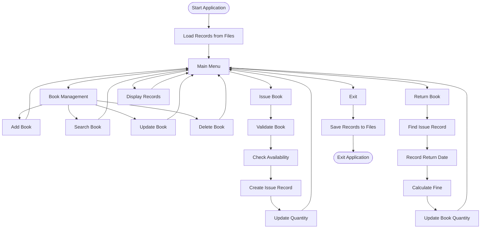
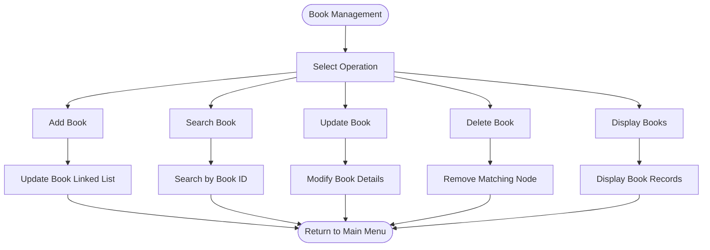
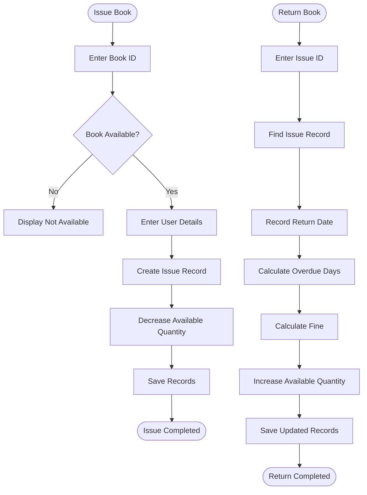
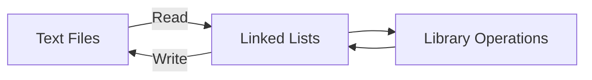

📚 Library Management System
A Console-Based Library Management Application Developed Using C

Efficient Book Management | Issue & Return Tracking | Fine Calculation

📌 Overview
Library Management System (LMS) is a menu-driven console application developed using the C programming language. It supports common library operations, including adding, viewing, searching, updating, and deleting book records, issuing books, processing returns, and calculating overdue fines.

The application uses Singly Linked Lists for dynamic record management and text-file handling to preserve records between program executions.
✨ Features
📚 Book Management
- ➕ Add books with Book ID, title, author, and quantity.
- 📋 Display book records.
- 🔍 Search for books using Book ID.
- ✏️ Update existing book details.
- 🗑️ Delete book records.
- 📦 Track available book quantities.
📖 Book Issue Management
- 📝 Issue available books to library users.
- 👤 Store User ID and User Name.
- 📅 Record issue dates and due dates.
- 📋 Maintain book issue records.
🔄 Book Return Management
- ↩️ Process previously issued books.
- 📅 Record the return date.
- 💰 Calculate fines for overdue books.
- 📦 Update available book quantity after a successful return.
💾 Data Management
- Store book records in BookRecord.txt.
- Store issue and return records in BookIssueRecord.txt.
- Load saved records when the application starts.
- Save updated records for later executions.
🛠️ Technologies & Concepts Used
Technology / Concept	Implementation
Programming Language	C
Data Structure	Singly Linked List
User-Defined Types	Structures
Memory Management	Dynamic Memory Allocation
Memory Operations	Pointers
Data Persistence	Text File Handling
File Functions	fopen(), fprintf(), fscanf(), fclose()
Memory Functions	malloc(), free()
Compiler	GCC
Build Automation	Makefile
Platform	Linux

🏗️ System Architecture

🔄 System Workflow
📚 Book Management Workflow

📖 Issue and Return Workflow

💰 Fine Calculation
The system calculates overdue fines by comparing the return date with the due date.

Formula:
Late Days = Return Date - Due Date
Fine Amount = Late Days × Fine Per Day
Condition	Fine
Returned before due date	₹0
Returned on due date	₹0
Returned after due date	₹5 per day

The date calculation should account for leap years when determining overdue days.
🗃️ Data Structures
The application uses structures and singly linked lists to maintain records dynamically.
Book Record
Field	Description
bookID	Unique book identification number
title	Book title
author	Author's name
quantity	Available book quantity
link	Pointer to the next book node

Issue Record
Field	Description
issueID	Unique issue identification number
bookID	ID of the issued book
userID	Library user's ID
userName	Library user's name
issueDate	Date of issuing the book
dueDate	Expected return date
returnDate	Actual return date
fineAmount	Calculated overdue fine
link	Pointer to the next issue node

📂 Project Structure
Library-Management-System/
│
├── headers.h
├── structure.h
├── main.c
│
├── addBook.c
├── delete.c
├── update.c
├── search.c
├── print.c
├── issueBook.c
├── returnBook.c
├── save.c
│
├── BookRecord.txt
├── BookIssueRecord.txt
│
├── Makefile
└── README.md

<b>📁 Module Descriptions</b>
File	Responsibility
main.c	Main function and menu handling
headers.h	Header files and function declarations
structure.h	Structure definitions
addBook.c	Adding book records
delete.c	Deleting book records
update.c	Updating book information
search.c	Searching for books
print.c	Displaying book and issue records
issueBook.c	Issuing books to users
returnBook.c	Returning books and calculating fines
save.c	Saving and loading records

💾 File Handling & Data Persistence
The application uses text files to preserve records between executions.
File Name	Stored Information
BookRecord.txt	Book ID, title, author, and quantity
BookIssueRecord.txt	Issue details, dates, return details, and fine

Data Flow

Saved records are loaded into linked lists when the application starts.
⚙️ Installation & Execution
Prerequisites
- GCC compiler
- Linux operating system or a compatible GCC environment
- Make utility (optional)
1. Clone the Repository
git clone <YOUR_REPOSITORY_URL>
2. Navigate to the Project Directory
cd Library-Management-System
3. Compile the Project
gcc -Wall -Wextra -std=gnu11 *.c -o LMS
4. Run the Application
./LMS
Using Makefile
make
make run
make clean
Note: The *.c compilation command assumes there is only one main() function among the C source files. If the directory contains test programs, compile with an explicit list of source files instead.

🧪 Suggested Test Cases
Test Case	Expected Result
Add a new book	Book record added successfully
Add an existing Book ID	Duplicate ID handled appropriately
Search for a valid Book ID	Matching book displayed
Search for an invalid Book ID	Book not found message
Update book details	Updated information displayed
Delete an existing book	Book record removed
Issue an available book	Issue record created and quantity decreased
Issue an unavailable book	Issue operation rejected
Return an issued book	Return date recorded and quantity increased
Return after due date	Fine calculated
Restart application	Previously saved records loaded

📷 Application Screenshots
Create an images/ directory in your repository and add your actual screenshots.

Main Menu
Book Management
Issue Book
Return Book

🔮 Future Enhancements
- 🔐 User authentication and administrator login.
- 🔎 Search books using title and author.
- 📚 Book reservation functionality.
- 📊 Generate library reports.
- 📅 Automatic due-date reminders.
- 🖥️ Graphical User Interface (GUI).
- 🗄️ Database integration for larger record management.
🎓 Learning Outcomes
Through this project, I gained practical experience in:
- Implementing Singly Linked Lists for dynamic data management.
- Understanding pointers and memory allocation.
- Working with structures and user-defined data types.
- Performing file operations using C.
- Managing records through modular programming.
- Implementing date calculations and fine management.
- Developing a menu-driven application.
👨‍💻 Author
Ishant Tikhe

C Programming | Data Structures | Embedded Systems

GitHub: @tikheishant

Built with ❤️ using C Programming
Library Management System | Singly Linked Lists | File Handling

⭐ If you find this project useful, consider giving the repository a star!

